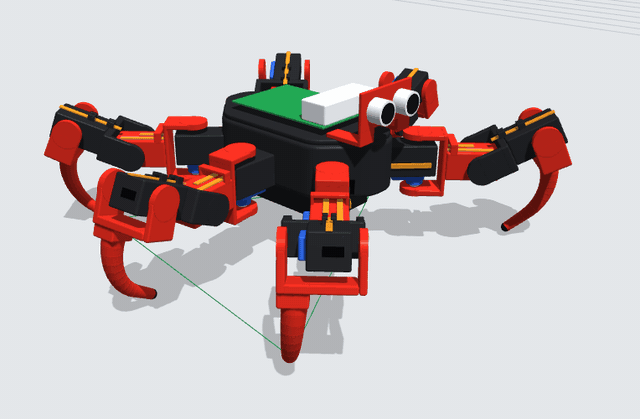
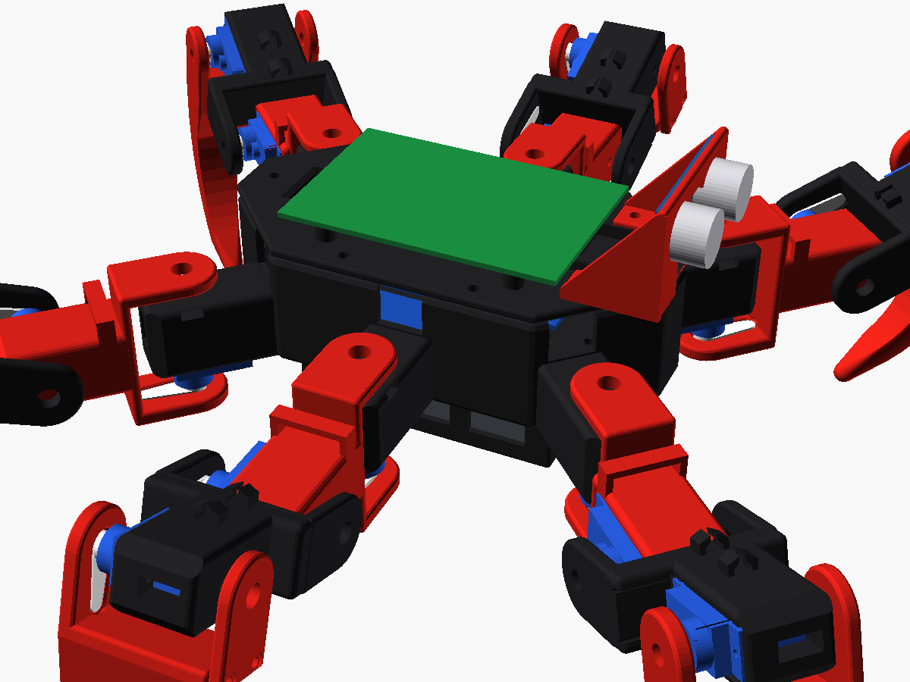
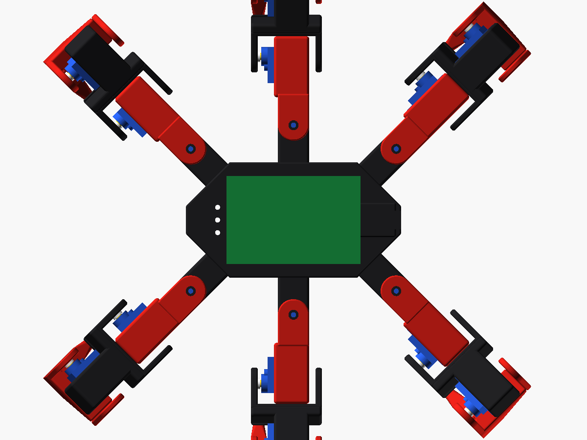
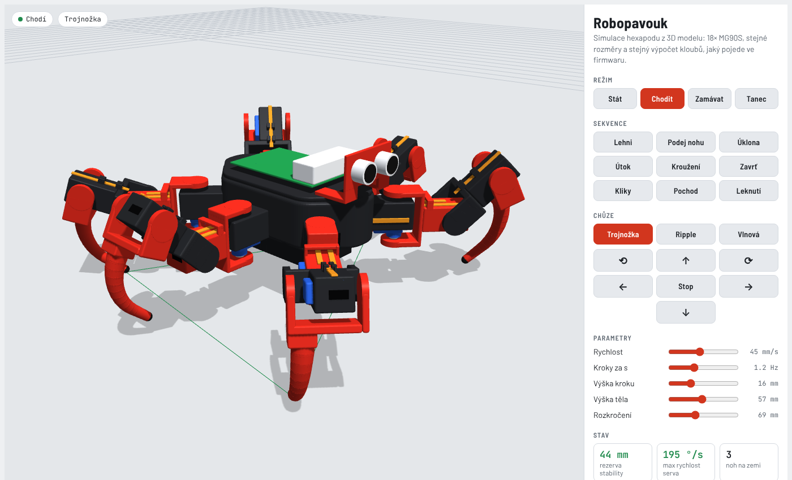
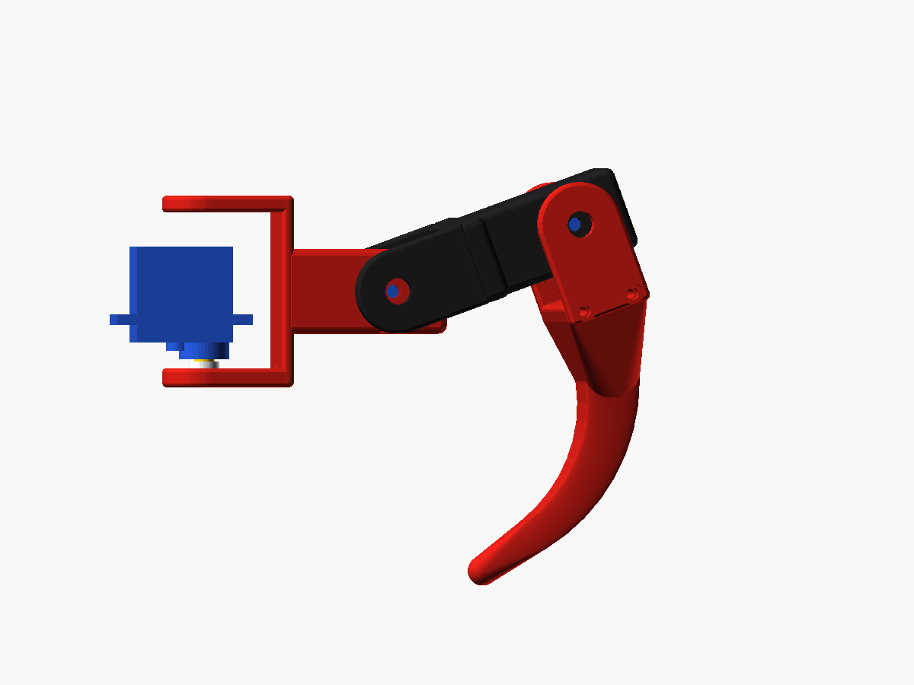
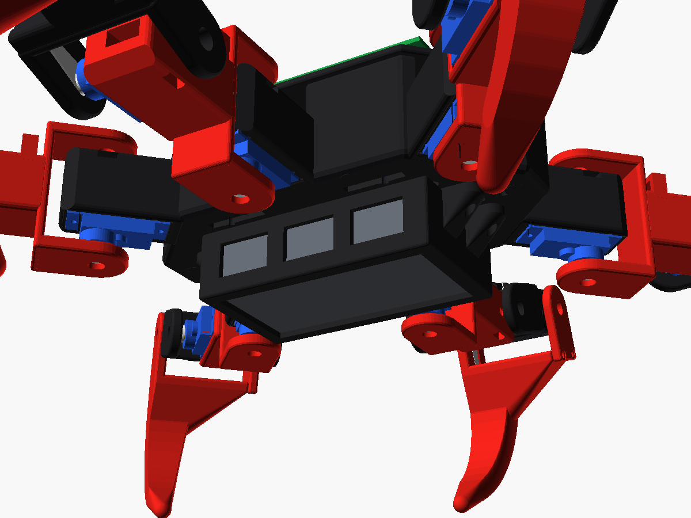
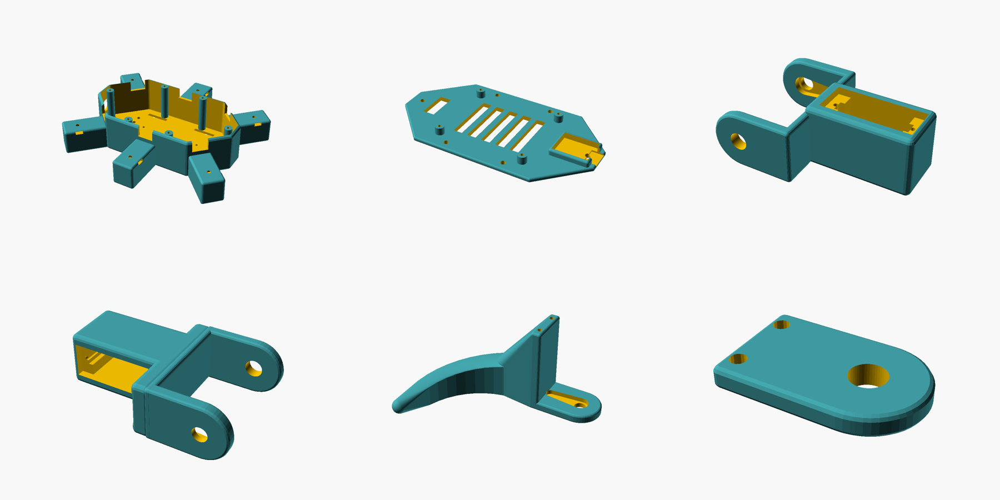
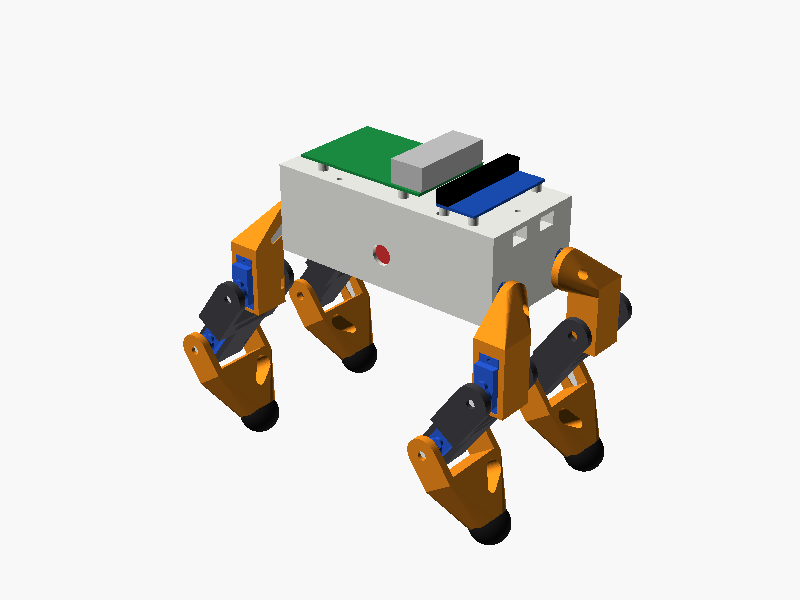

# Robopavouk

**Šestinohý chodící robot (hexapod) z 3D tiskárny.** 18 servomotorů MG90S, dvě desky PCA9685, mozek ESP32-C3 a ultrazvukový senzor na „čele“. Celý robot je navržený parametricky v OpenSCADu, tiskne se bez podpěr a ovládá se z mobilu přes WiFi.

<p align="center">
  
</p>

<p align="center">
  
  
</p>

| | |
|---|---|
| **Stav** | 3D model hotový (verze 2.2), firmware napsaný a otestovaný na počítači, tisk a stavba probíhá |
| **Rozpětí** | asi 310 × 330 mm, trup 136 × 73 mm |
| **Hmotnost** | odhadem 765 g (s ESP32-C3) |
| **Pohony** | 18× MG90S, 3 na nohu (coxa, stehno, koleno) |
| **Řízení** | ESP32-C3 SuperMini + 2× PCA9685 (I²C) |
| **Napájení** | 2S Li-ion (2× 18650), 2× step-down na 6,0 V |
| **Senzory** | ultrazvuk HC-SR04 |
| **Ovládání** | WiFi stránka v mobilu nebo sériová linka |

## Obsah

- [Simulátor](#simulátor)
- [Co robot umí](#co-robot-umí)
- [Mechanika](#mechanika)
- [Elektronika](#elektronika)
- [Firmware](#firmware)
- [Jak postavit](#jak-postavit)
- [Struktura repozitáře](#struktura-repozitáře)
- [Robopes](#robopes)

## Simulátor

V [`robospider/sim/robopavouk.html`](robospider/sim/robopavouk.html) je 3D simulátor robota. **[▶ Spustit simulátor v prohlížeči](https://htmlpreview.github.io/?https://github.com/SkadiCZ/robopavouk/blob/main/robospider/sim/robopavouk.html)**, nebo ho stáhni a otevři ze svého počítače. Používá stejné rozměry jako 3D model a stejný výpočet kloubů (inverzní kinematiku) jako firmware, takže co chodí v simulátoru, má chodit i na skutečném robotu.



Simulátor umí:
- tři druhy chůze (trojnožka, ripple, vlnová), chůzi všemi směry včetně krabí chůze do strany a otáčení na místě,
- všechny sekvence z firmwaru (vstávání, lehání, podání nohy, úklona, útok, tanec, kliky, pochod…),
- ladění parametrů chůze: rychlost, frekvence kroků, výška kroku, výška těla, rozkročení,
- živou kontrolu: rezerva stability (jestli těžiště zůstává nad oporou), nejvyšší rychlost serva proti možnostem MG90S a úhly všech 18 serv tak, jak je dostane PCA9685.

## Co robot umí

| Skupina | Příkazy |
|---|---|
| Pohyb | `vstan`, `lehni`, `vpred`, `vzad`, `vlevo`, `vpravo` (krabí chůze), `otoc_l`, `otoc_p`, `stop` |
| Druh chůze | `chuze tripod` (rychlá), `chuze ripple` (střední), `chuze vlna` (nejpomalejší a nejšetrnější) |
| Triky | `mavej`, `podej`, `uklona`, `utok`, `tanec`, `krouzeni`, `zavrt`, `kliky`, `pochod` |
| Senzor | `pruzkum` (chodí sám a vyhýbá se překážkám), `nasleduj` (jde za rukou), `hlidej` (zastaví před překážkou), `lek` (lekne se, když se něco přiblíží) |
| Nálada | `zivy`: když stojí, lehce „dýchá“ a rozhlíží se |

Úplný seznam příkazů včetně kalibrace je ve [firmware/README.md](robospider/firmware/README.md#ovládání).

## Mechanika

Každá noha má tři klouby: **coxa** (otáčí nohou kolem svislé osy v trupu), **stehno** a **koleno** s obloukovým bércem. Všechny klouby jsou uložené **oboustranně**: z jedné strany je drží páka serva, z druhé ocelový čep M3 v tištěném pouzdře. Servo tak nenese boční síly samo.

<p align="center">
  
  
</p>

- Délky segmentů: coxa 43,5 mm, stehno 46 mm, bérec asi 82 mm po oblouku.
- Rozsahy pohybu ověřené kolizní kontrolou modelu: coxa ±60°, stehno 90° nahoru až 60° dolů, koleno −40° až +110°.
- Kapsy serv mají lisovací žebra, takže servo sedí bez vůle i na méně přesné tiskárně. Uložení se ladí na zkušebním kusu `servo_test.stl`.
- Kabely vedou okny v kapsách serv, úchyty na stehnech, očky na coxách a okny v trupu.
- Pod trupem je kolébka na držák 2× 18650, na víku podstavce pro ESP32-C3 (nebo Raspberry Pi) a držák ultrazvukového senzoru.



**Tisk:** PETG nebo PLA+, vrstva 0,2 mm, 3 perimetry, 20–25 % gyroid, **bez podpěr**. Návleky na špičky nohou z TPU (volitelné). Celkem 13 druhů dílů, seznam s počty kusů je v [robospider/README.md](robospider/README.md#díly-k-tisku).

## Elektronika

```
 2S Li-ion 7,4 V ──┬── step-down 6,0 V ── PCA9685 0x40 ── 9 serv levých noh
  (BMS 10 A)       ├── step-down 6,0 V ── PCA9685 0x41 ── 9 serv pravých noh
                   └── 5 V ── ESP32-C3 ── I²C (GPIO8/9) ── obě PCA9685
                                └──────── GPIO4/5 ── HC-SR04 (ECHO přes dělič)
```

- Serva běží na **6,0 V**, kde má MG90S asi 2,2 kg·cm. Stehenní servo při trojnožkové chůzi potřebuje asi 0,9 kg·cm.
- Při chůzi bere robot průměrně 3–4 A, ve špičkách 8–10 A. Výdrž odhadem 35–45 minut.
- Podrobné zapojení, kusovník a výpočet zatížení jsou v [robospider/README.md](robospider/README.md#napájení-a-elektronika).

## Firmware

Program pro ESP32-C3 je v [`robospider/firmware/`](robospider/firmware/). Nepotřebuje žádné další knihovny, ovladač PCA9685 má vlastní.

- `motion.h`: inverzní kinematika, chůze a sekvence. Je to čisté C++ převzaté ze simulátoru.
- `robospider.ino`: serva, senzor, příkazy, WiFi přístupový bod `Robopavouk` s ovládací stránkou na `http://192.168.4.1`.
- `config.h`: piny, adresy, směry serv a vzdálenosti pro senzor.
- Kalibrace (střed, směr a doladění každého serva) se ukládá natrvalo do paměti ESP32.

Pohybové jádro jde otestovat na počítači:

```
cd robospider/firmware/test
g++ -std=c++11 -O2 -o test_motion test_motion.cpp && ./test_motion
```

Test projde všechny chůze a sekvence a ověří, že žádný kloub nepřekročí rozsah modelu, servo nepotřebuje víc než 350 °/s a těžiště zůstává nad oporou.

> **Zatím neověřeno na skutečném robotu:** překlad v Arduino IDE pro ESP32-C3 a směry otáčení serv (ty se nastaví při kalibraci).

## Jak postavit

1. Vytiskni `servo_test.stl` a vyzkoušej, jak sedí servo a páka. Případně uprav vůle v `robospider.scad` a přeexportuj STL.
2. Vytiskni a sestav jednu nohu, ať ověříš kabely a rozsahy kloubů.
3. Na stole oživ elektroniku: ESP32-C3, obě PCA9685, step-downy, příkaz `stav`.
4. Vytiskni zbytek dílů a smontuj robota. Serva před nasazením pák vycentruj na 90° (`stred`).
5. Zkalibruj směry a středy serv (`test`, `smer`, `trim`) s robotem na krabičce.
6. Polož ho na stůl a dej `vstan`. Začni vlnovou chůzí, trojnožku až pak.

Podrobný postup montáže je v [robospider/README.md](robospider/README.md#postup-montáže), kalibrace ve [firmware/README.md](robospider/firmware/README.md#první-spuštění-a-kalibrace).

Jiný díl vyexportuješ z OpenSCADu takto:

```
openscad -D 'part="femur"' -o femur.stl robospider/scad/robospider.scad
```

## Struktura repozitáře

```
robospider/
  scad/robospider.scad    parametrický model, všechny díly i sestava
  stl/                    díly k tisku, už otočené do tiskové polohy
  img/                    náhledy dílů a sestavy
  firmware/               program pro ESP32-C3 a test pohybového jádra
  sim/robopavouk.html     3D simulátor chůze
  archive_v1/             starší verze modelu
robodog/                  starší projekt čtyřnohého robota
docs/img/                 obrázky pro tohle README
```

## Robopes

Ve složce [`robodog/`](robodog/) je předchozí projekt: malý čtyřnohý robot ve stylu SpotMicro s 12 servy MG90S. Je hotový jen jako 3D model a dál se nevyvíjí. Kloubové moduly (kapsa serva, vidlice s čepem, otisk páky) má stejné jako pavouk.

<p align="center">
  
</p>
