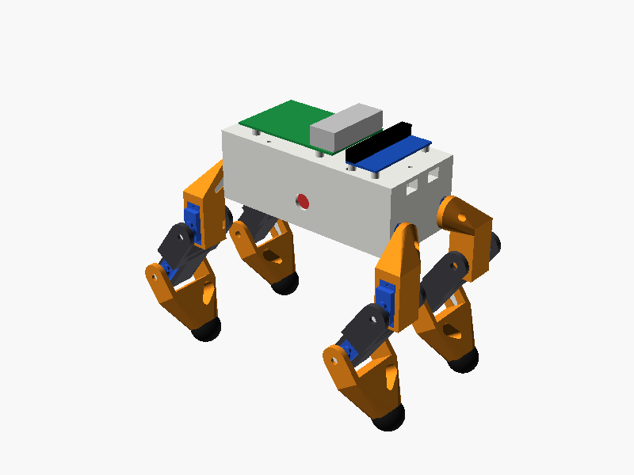

# Robopes mini: 3D tisknutelný čtyřnohý robot

Malý pes ve stylu SpotMicro / Boston Dynamics Spot: **12× MG90S** (3 na nohu), mozek **Raspberry Pi 4B**, řízení serv přes **PCA9685**, napájení **2S Li-ion (2× 18650)**.
Tohle je verze 1, tedy jen mechanika a 3D model. Programování přijde později.

## Soubory

| Cesta | Co to je |
|---|---|
| `scad/robodog.scad` | celý parametrický model (všechny díly + sestava) |
| `stl/*.stl` | díly připravené k tisku, už otočené do tiskové polohy |
| `img/*.png` | náhledy sestavy a jednotlivých dílů |

Jiný díl se exportuje takhle: `openscad -D 'part="femur"' -o femur.stl scad/robodog.scad`.
Rozměry se mění nahoře v souboru: vůle `clr`, rozměry MG90S, rozměry páky (`horn_*`), délky nohou `L1`/`L2` a rozměry trupu `Lb/Wb/Hb`.

## Základní parametry

- Rozměry: zhruba 230 × 140 mm (délka × šířka). V základním postoji je spodek trupu asi 120 mm nad zemí a horní deska asi 175 mm. Při víc pokrčených nohách se dá jít níž.
- Hmotnost: odhadem 600–650 g, z toho asi 230 g tištěné díly.
- Noha: stehno 55 mm (osa ramene → osa kolene), bérec 62 mm (osa kolene → zem).
- Klouby na noze:
  - **kyčel** (odtažení do strany, osa X): servo je v čele trupu.
  - **rameno** (osa Y): servo je v rameni, stehno ho obepíná vidlicí.
  - **koleno** (osa Y): servo je ve spodní části stehna, bérec ho obepíná vidlicí.
- Rameno a koleno jsou uložené **oboustranně**: z jedné strany drží páka serva, z druhé ocelový čep M3 s tištěným pouzdrem. Servo tak nenese boční síly samo.
- Rozsahy pohybu ověřené kolizní kontrolou modelu:
  - rameno ±90°
  - koleno ±110°
  - kyčel ±35° (při libovolném postavení ramene ±60° nenarazí do trupu)
- Souřadnice os pro pozdější inverzní kinematiku (mm, střed spodku trupu = 0, X dopředu, Y doleva, Z nahoru):
  - kyčelní osy jsou na (±72, ±26, 14)
  - ramenní osy jsou na (±88, ±58, −24)
- Zatížení serv: v klusu (pes stojí na 2 nohách) potřebuje koleno asi 1,1 kg·cm. MG90S dává zhruba 2,2 kg·cm při 6 V, takže je rezerva zhruba dvojnásobná.

## Kusovník (BOM)

**Elektronika**
- 12× MG90S, každé s jednoramennou pákou a šroubky ze sáčku (máš 20, zbylých 8 jsou náhradní).
- 1× Raspberry Pi 4B.
- 1× PCA9685, 16kanálový servo driver (I²C, rozteč děr 55,9 × 19 mm).
- 2× článek 18650 s ochranou + držák 2S (77 × 41 mm). Alternativa: 2S LiPo 1000–1500 mAh.
- 1× step-down pro serva, **minimálně 5 A** (např. XL4015), nastavený na 6,0 V.
- 1× step-down pro Pi, 5,1 V / **minimálně 3 A**, připojený přes 5V piny GPIO nebo USB-C.
- 1× kulatý vypínač do otvoru Ø12 mm v boku trupu.
- 8× prodlužovací kabel serva 10–15 cm (pro ramena a kolena).
- Volitelně na později: IMU MPU-6050 a ultrazvukový senzor HC-SR04.

**Spojovací materiál**
- 8× šroub M3×12 + 8× matice M3 + 8× podložka M3 (čepy ramen a kolen).
- 24× samořezný šroub M2×6–8 do oušek serv (často jsou v balení serv).
- 6× samořezný šroub M3×8 na víko.
- 8× šroub M2,5×6 na Pi a PCA9685 (řežou se do otvorů Ø2,2 v podstavcích).
- Suchý zip na baterii, stahovací pásky.

## Díly k tisku

| STL | Ks | Poznámka |
|---|---|---|
| `servo_test.stl` | 1 | **vytiskni jako první**: držák serva + kousek desky s otiskem páky, ověří lícování |
| `body.stl` | 1 | trup, tiskne se dnem dolů |
| `lid.stl` | 1 | víko s podstavci pro Pi a PCA9685 |
| `shoulder_L.stl` | 2 | levé přední + pravé zadní |
| `shoulder_R.stl` | 2 | pravé přední + levé zadní (zrcadlo) |
| `femur.stl` | 4 | stehno, stejné pro všechny nohy |
| `tibia.stl` | 4 | bérec, stejný pro všechny nohy |
| `bushing.stl` | 8 (+2 rezerva) | pouzdra čepů |
| `foot_cap.stl` | 4 | **TPU**, gumová chodidla (volitelné) |

### Nastavení tisku
- Materiál: PETG nebo PLA+. Na chodidla TPU 95A.
- Vrstva 0,2 mm, 3–4 perimetry, výplň 25–30 % gyroid.
- **Podpěry nejsou potřeba.** STL jsou otočená tak, aby díly ležely rovnou plochou na podložce a převisy byly jen mosty do 33 mm.
- Ramena, stehna a bérce se tisknou na boku, takže vrstvy jdou podél nohy a díl je pevnější.
- Na trup se hodí brim 5 mm, protože jde o dlouhý díl.
- Když servo v testovacím kusu drží moc natěsno nebo moc volně, uprav `clr` (výchozí 0,3 mm) a STL přeexportuj. Když nesedí otisk páky, uprav `horn_hub_d`, `horn_arm_len` a `horn_tip_d`.

## Postup montáže

1. **Vycentruj všechna serva na 90°**, ještě než nasadíš páky. Stačí servo tester nebo krátký skript přes PCA9685. Bez toho budou nohy nasazené pod náhodným úhlem.
2. **Kyčelní serva (4×) do trupu.** Servo vlož zevnitř do kapsy v čele trupu tak, aby hřídel koukal ven. Ouška přišroubuj zevnitř šrouby M2 do stěny.
3. **Ramenní serva do ramen.** Servo zasuň do kapsy hřídelem ven a ouška přišroubuj M2.
4. **Páky do desek.** Jednoramennou páku vlož do otisku na vnitřní straně desky (rameno, stehno, bérec). Přišroubuj ji drobnými šroubky ze sáčku přes otvory v páce do plastu, předvrtat lze vrtákem 1,5 mm.
5. **Stehno na rameno.** Vidlici stehna nasuň z boku tak, aby držák serva vjel mezi desky. Pak servo nadzvedni na drážkovaný hřídel páky. Středový šroub páky dotáhni otvorem v desce.
6. **Čep.** Do spodní desky vidlice zasuň tištěné pouzdro, do boční kapsy v dně držáku vlož matici M3. Šroub M3×12 s podložkou dotáhni přes pouzdro. Pouzdro je o 0,3 mm delší než deska, takže kloub nebude drhnout.
7. Kroky 3–6 zopakuj pro **kolenní servo** ve stehně a **bérec**.
8. **Rameno na kyčelní servo** nasaď deskou s pákou, středový šroub dotáhni otvorem v desce.
9. **Kabely** veď po noze ke stahovacím páskám a do trupu zářezy v horní hraně čela a zadní stěny. Nech jim vůli na plný pohyb kloubů.
10. **Elektronika:** baterii připevni suchým zipem na dno, step-downy přišroubuj do mřížky děr M3 v podlaze. Pi a PCA9685 patří na víko. Víko přišroubuj 6× M3.
11. Volitelně navleč na chodidla TPU návleky.

## Co je předpoklad a co ověřit
- Produkt z AliExpress odkazu se nepodařilo načíst. Vzhled je proto navržený jako mini SpotMicro, tedy krabicový trup a nohy s koleny dozadu.
- Rozměry MG90S jsou podle běžného výkresu: pouzdro 22,8 × 12,2 × 22,5 mm, rozteč oušek 27,8 mm, hřídel 5,9 mm od čela. Kusy od různých výrobců se liší o desetiny milimetru, proto je dobré nejdřív vytisknout `servo_test`.
- Tvar jednoramenné páky se mezi sadami liší. Rozměry otisku jsou parametry nahoře v souboru.
