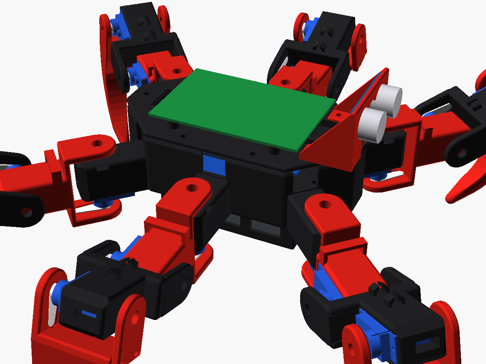

# Robopavouk: 3D tisknutelný hexapod (18× MG90S)

Šestinohý chodící robot ve stylu fotky: šestiúhelníkový trup, každá noha má 3 serva (coxa, stehno, koleno) a obloukový bérec se špičkou.
Mechanika a 3D model jsou ve složkách `scad` a `stl`, program pro ESP32-C3 je ve složce `firmware`.

Verze 1.1 (10. 11. 2026): všechny hrany jsou zaoblené (parametry `r_edge`, `r_plate`, `r_body` ve scad) a barvy jsou trup, víko a stehna černé, coxa a bérce červené. Rozměry, kloubové osy i rozsahy pohybu zůstaly stejné. Původní verze je v `archive_v1/`.

## Soubory

| Cesta | Co to je |
|---|---|
| `scad/robospider.scad` | parametrický model (všechny díly + sestava) |
| `stl/*.stl` | díly k tisku, už otočené do tiskové polohy |
| `img/*.png` | náhledy |
| `firmware/` | program pro ESP32-C3: chůze, sekvence, ultrazvukový senzor (viz `firmware/README.md`) |
| `sim/robopavouk.html` | simulátor chůze |

Export jiného dílu: `openscad -D 'part="femur"' -o femur.stl scad/robospider.scad`.
Kloubové moduly (kapsa serva, vidlice s čepem M3, otisk páky) jsou stejné jako u robopsa. Zkušební kus `servo_test.stl` proto platí pro oba roboty.

## Základní parametry

- Rozpětí zhruba 310 × 330 mm (délka × šířka), trup 136 × 73 mm.
- V základním postoji jsou špičky asi 57 mm pod osou coxa serv. Kolébka baterie pod trupem je asi 38 mm nad zemí.
- Délky segmentů:
  - coxa 43,5 mm
  - stehno 46 mm
  - bérec asi 82 mm po oblouku
- Všechny klouby jsou uložené **oboustranně**: z jedné strany drží páka serva, z druhé ocelový čep M3 v tištěném pouzdře.
- Rozsahy pohybu ověřené kolizní kontrolou modelu:
  - coxa ±60° proti trupu
  - stehno od 90° nahoru po 60° dolů
  - koleno −40° … +110°
- Sousední nohy: dvě nohy se smí natočit každá o 20° proti sobě, nebo jedna sama o 40°. Při 30° + 30° se srazí. Typická chůze potřebuje kolem ±20°.

### Souřadnice pro pozdější inverzní kinematiku
- Počátek je ve středu trupu, Z = 0 je spodní plocha pouzder coxa serv (osa hřídele). X dopředu, Y doleva.
- Osy coxa: přední (±65, ±45) pod úhlem ±45°, prostřední (0, ±60) pod ±90°, zadní (−65, ±45) pod ±135°.
- Osa stehna je 43,5 mm od osy coxa radiálně a 12 mm výš.
- **Rovina nohy je posunutá do strany o 22 mm** od radiály coxa, tedy proti směru hodinových ručiček u levých noh a zrcadlově u pravých. Inverzní kinematika s tím musí počítat.
- Základní póza: coxa 0°, stehno 20° nad vodorovnou, koleno 90° od přímé polohy. V této póze se při montáži vycentrovaných serv nasazují páky.

## Zatížení serv (MG90S)

| Položka | Hmotnost |
|---|---|
| 18× MG90S | 241 g |
| tisk (~490 cm³ objemu, 3 perimetry, 25 % výplň, PETG) | ~310 g |
| 2× PCA9685 | 18 g |
| 2× step-down 5 A | ~36 g |
| 2× 18650 + držák (nebo 2S LiPo) | ~107 g |
| kabely, šrouby | ~50 g |
| **ESP32-C3** jako mozek | 3 g → **celkem ~765 g** |
| **Raspberry Pi 4B** + 5V step-down | 56 g → **celkem ~820 g** |

- **Nejhorší běžný případ je trojnožková chůze (tripod).** Robot stojí na 3 nohách a prostřední z nich nese asi 42 % váhy. Prostřední nohy jsou proto posazené víc do stran.
- Při váze 820 g a páce chodidla 26 mm dostane stehenní servo asi **0,9 kg·cm** a koleno asi 0,6 kg·cm.
- MG90S dává zhruba 1,8 kg·cm při 4,8 V a **2,2 kg·cm při 6 V**. Stehno tak jede asi na 40 % síly při 6 V. Na rovině to stačí, ale rezerva není velká.
- Doporučení:
  - Napájej serva **6,0 V**, ne 5 V.
  - Jako mozek dej přednost **ESP32-C3**, pokud nepotřebuješ kameru. Ušetříš asi 55 g a 3–5 W.
  - Pro delší chůzi a do terénu používej vlnovou nebo ripple chůzi (na zemi 4–5 noh). Tripod nech na rychlou chůzi po rovině.
  - Nevstávej z břicha s nohama roztaženýma do stran, kde je páka 3× větší. Nejdřív přitáhni chodidla pod tělo.
  - Coxa serva nenesou váhu, jen otáčejí nohou kolem svislé osy.

## Napájení a elektronika

- **2× PCA9685:**
  - Deska 1 = adresa 0x40 (výchozí), ovládá levé nohy, kanály 0–8.
  - Deska 2 = adresa 0x41 (zapájej propojku A0), ovládá pravé nohy, kanály 0–8.
  - Obě visí na stejné I²C sběrnici. Volných zůstává 7 kanálů na každé desce.
- **Proč ne jedna PCA9685 + ESP32-C3 na zbylá 2 serva:** ESP32-C3 má jen 6 PWM kanálů a časování přes dva různé řadiče se hůř ladí. Druhá PCA9685 stojí pár desítek korun.
- **Mozek:** ESP32-C3 SuperMini (kolébka na víku, I²C SDA = GPIO8, SCL = GPIO9) nebo Raspberry Pi 4B (podstavce 58 × 49 mm na víku, I²C GPIO2/3).
- **Proud:**
  - MG90S bere naprázdno asi 0,15–0,2 A, zatížený 0,3–0,5 A a zablokovaný až asi 0,8 A při 6 V.
  - Při chůzi počítej průměrně s 3–4 A, ve špičkách 8–10 A.
- **Napájení serv:** 2× step-down 5 A (např. XL4015) nastavené na 6,0 V. Každý napájí jednu PCA9685, tedy 9 serv na jedné straně. Ke svorkám V+ každé PCA dej kondenzátor 1000 µF / 16 V.
- **Pi:** samostatný step-down 5,1 V / 3 A. ESP32-C3 stačí napájet z 5 V přes USB-C nebo z malého 5V regulátoru.
- **Baterie:** 2S, tedy 2× 18650 s vysokým vybíjecím proudem, **min. 10 A** (Samsung 25R, Molicel P26A, Sony VTC5A). Patří k ní 2S BMS 10 A. Alternativa je 2S LiPo 1300–1800 mAh 25C s XT30.
  - Ze 7,4 V odebírá robot při chůzi asi 4 A, ve špičkách asi 9 A.
  - Výdrž je odhadem 35–45 min chůze.
- Všechny GND musí být propojené. Logické VCC PCA9685 je 3,3 V z mozku.

## Kusovník (BOM)

**Elektronika**
- 18× MG90S s jednoramennými pákami (zbylé 2 ze tvých 20 jsou náhradní).
- 2× PCA9685 (jednu máš, druhou dokup).
- 1× ESP32-C3 SuperMini (doporučeno), nebo Raspberry Pi 4B + step-down 5,1 V / 3 A.
- 2× step-down 5 A (XL4015).
- 2× 1000 µF / 16 V.
- 2× 18650 s vysokým proudem + držák 2S + BMS 2S 10 A, nebo 2S LiPo s XT30.
- Vypínač do otvoru Ø12 mm v zadní stěně, min. 10 A (nebo místo něj konektor XT30).
- Případně prodlužovací kabely serv 10 cm ke kolenům.
- Ultrazvukový senzor HC-SR04 + rezistory 1 kΩ a 2 kΩ (dělič na ECHO).

**Spojovací materiál**
- 18× M3×12 + 18× matice M3 + 18× podložka M3 (čepy všech kloubů).
- 36× samořezný M2×6–8 do oušek serv.
- 12× samořezný M2,5×8 (víčka bérců).
- 6× samořezný M3×8 (víko).
- 4× M3×10 + matice (kolébka baterie).
- 2× M3×10 + matice (držák senzoru na víku).
- 8× M2,5×6 na PCA9685 a 4× na Pi.
- Držák 2× 18650 s vývody (cca 77 × 41 × 21 mm) do kolébky pod trupem. Jiný rozměr nastavíš parametry `bat_L`, `bat_W`, `bat_H`.
- Stahovací pásky.

## Díly k tisku

| STL | Ks | Poznámka |
|---|---|---|
| `servo_test.stl` | 1 | **vytiskni jako první**, ověří lícování serva, páky a drážky na kabel |
| `body.stl` | 1 | vana trupu se 6 držáky coxa serv, tiskne se dnem dolů |
| `lid.stl` | 1 | víko s podstavci pro Pi a kolébkou ESP32-C3 |
| `coxa_L.stl` | 3 | levé nohy |
| `coxa_R.stl` | 3 | pravé nohy (zrcadlo) |
| `femur.stl` | 6 | stehno, stejné pro všechny nohy |
| `tibia_L.stl` | 3 | bérec levý |
| `tibia_R.stl` | 3 | bérec pravý (zrcadlo) |
| `tibia_cap.stl` | 6 | čepová deska bérce, přišroubuje se 2× M2,5 |
| `bushing.stl` | 18 (+2) | pouzdra čepů |
| `sonar_mount.stl` | 1 | držák ultrazvukového senzoru HC-SR04 na víko, tiskne se čelní deskou dolů |
| `battery_cradle.stl` | 1 | kolébka pod trup pro standardní držák 2× 18650 (77 × 41 × 21 mm), tiskne se lemem dolů |
| `tip_cap.stl` | 6 | **TPU** návleky na špičky (volitelné, lepší grip) |

**Nastavení:**
- Materiál: PETG nebo PLA+, na návleky TPU 95A.
- Vrstva 0,2 mm, 3 perimetry, 20–25 % gyroid.
- **Podpěry nejsou potřeba.**
- Coxa a stehna se tisknou na boku, bérce naplocho (oblouk leží na podložce, stěna kloubu stojí nahoru).
- Na trup se hodí brim 5 mm.

## Postup montáže

1. Vytiskni `servo_test`. Ladění uložení (v2) je v sekci „uložení serva“ ve scad:
    - `sclr` = vůle kapsy kolem serva (0,4 mm). Servo drží 4 lisovací žebra (`rib_h` = 0,35 mm), která se při zasunutí trochu zamáčknou, takže servo sedí bez vůle i na různě přesných tiskárnách.
    - Jde-li servo moc ztuha, zmenši `rib_h` (např. 0,2). Když se viklá, zvětši ho (0,5).
    - Rohy kapsy mají odlehčení a ústí náběh, aby servo nedrhlo o zaoblené rohy tisku.
    - Páka: `horn_clr` (0,35 mm na stranu) a náběh na ústí vybrání.
    - Po úpravě přeexportuj STL.
2. **Všech 18 serv vycentruj na 90°** přes PCA9685 nebo servo testerem, ještě než nasadíš páky.
3. **Coxa serva** zasuň do 6 držáků trupu zespodu, hřídelem dolů, a ouška přišroubuj M2.
4. Do spodní desky každé vidlice (coxa, stehno, bérec) vlož jednoramennou páku a přišroubuj ji šroubky ze sáčku. Předvrtat lze 1,5 mm.
5. **Coxa:** do držáku v coxe zasuň stehenní servo. Pak vidlici coxy nasuň zvenku na coxa servo v trupu, nadzvedni ji na drážkování a dotáhni středový šroub otvorem v desce. Nahoře zasuň pouzdro, do kapsy v dně držáku vlož matici a dotáhni šroub M3×12 s podložkou.
6. **Stehno** nasuň stejně na stehenní servo. Pak do stehna vlož kolenní servo.
7. **Bérec** nasaď deskou s pákou na kolenní servo. Zespodu přiložte `tibia_cap` s pouzdrem a přišroubuj ji 2× M2,5.
8. Páky nasazuj tak, aby vycentrované servo odpovídalo základní póze: coxa kolmo od trupu, stehno 20° nahoru, koleno 90°. Drážkování má krok 18°, zbytek se doladí v softwaru.
9. **Kabely:**
    - Každá kapsa serva má v čelní stěně u hřídele okno pro kabel 5,2 mm široké (`cab_w`) a nad ním můstek 5 mm (`brg_t`). Kabel s konektorem protáhni oknem, pak servo zasuň a obě ouška přišroubuj.
    - Rohy čela držáku jsou zkosené (`cab_ch`), takže kabel projde kolem stěny vidlice dalšího kloubu do strany.
    - **Koleno:** kabel veď po horní ploše stehna a zacvakni ho do dvou úchytů. Plochý kabel se protlačí štěrbinou na hranu a uvnitř si lehne naplocho.
    - **Coxa:** kabely kolenního a stehenního serva protáhni očkem na horní ploše coxy (projde i konektor) a dál zářezem v horní hraně trupu.
    - **Coxa servo v trupu:** kabel veď oknem ve stěně trupu hned vedle držáku, je nízko u dna.
    - Všude nech vůli na plný pohyb kloubů, hlavně přes kyčel a koleno.
10. **Elektronika:**
    - PCA9685 přišroubuj na podstavce v trupu, step-downy do mřížky děr M3 vpředu a vzadu.
    - Baterie: držák 2× 18650 vlož do kolébky otevřenou stranou dolů (články jdou vyndat zespodu) a kolébku přišroubuj 4× M3×10 s maticí do mřížky děr v dně trupu. Vodiče vedou výřezem vzadu a otvorem Ø6 do trupu.
    - Víko přišroubuj 6× M3, mozek je na víku.

## Předpoklady k ověření
- Rozměry MG90S jsou podle běžného výkresu, rozměry páky se mezi sadami liší. Proto je potřeba nejdřív `servo_test`.
- Hmotnost tisku je odhad z objemu dílů. Skutečnou hmotnost ti ukáže slicer.
